# Meta-heuristic Algorithms

Implementations of classic meta-heuristic and optimization algorithms from scratch in Python and NumPy, with experiments on their hyperparameters, convergence and time complexity. The project was written for the university course *Optimization Algorithms Based on Evolutionary Computing* and lives in one Jupyter notebook, [`ProjectGuide.ipynb`](ProjectGuide.ipynb).

It covers:

- **Local search:** hill climbing and simulated annealing
- **Swarm intelligence:** particle swarm optimization and ant colony optimization
- **Evolutionary computation:** a genetic algorithm with several selection, crossover and mutation operators
- **Other:** gradient descent with numerical gradients, Needleman-Wunsch sequence alignment, and A* with two meta-heuristic variants of my own
- **Final task:** a constrained Vehicle Routing Problem solved with a GA and ACO, whose hyperparameters are tuned by simulated annealing and hill climbing

## Contents

| # | Task | Problem |
|---|---|---|
| 1–2 | Hill climbing (random restarts, greedy variant) and time complexity | Rosenbrock, Griewank (N-dimensional) |
| 3–4 | Simulated annealing with 5 cooling schedules and their evaluation | Rastrigin |
| 5–7 | Particle swarm optimization and a sweep of `w`, `c1`, `c2` | Rastrigin, Rosenbrock, Griewank |
| 8–9 | Ant colony optimization and a sweep of `α`, `β`, `ρ` and the number of ants | Traveling Salesman Problem |
| 10–11 | Genetic algorithm and hyperparameter experiments | 10-D Rastrigin, 0/1 knapsack |
| 12 | PyGAD library | Knapsack, Rastrigin |
| 13–14 | Needleman-Wunsch alignment and its time complexity | Sequence alignment |
| 15–16 | Gradient descent with exact vs. numerical gradients | Quadratic, Rastrigin |
| 17 | GA and ACO on a Vehicle Routing Problem, tuned by SA and hill climbing | VRP with time windows |
| 18 | A*, meta-heuristic A* and multi-agent A* | Generated mazes |

## Hill climbing

N-dimensional hill climbing with random restarts, plus a greedy variant that evaluates several neighbours per step. On the 5-D Griewank function, ten independent searches show how much the result depends on the starting point:

<p align="center">
  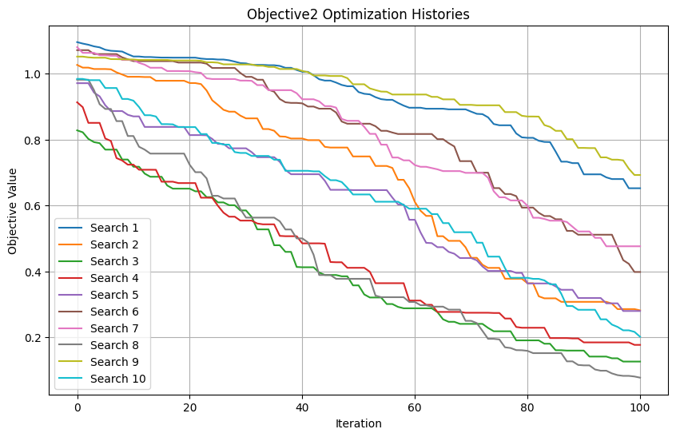
  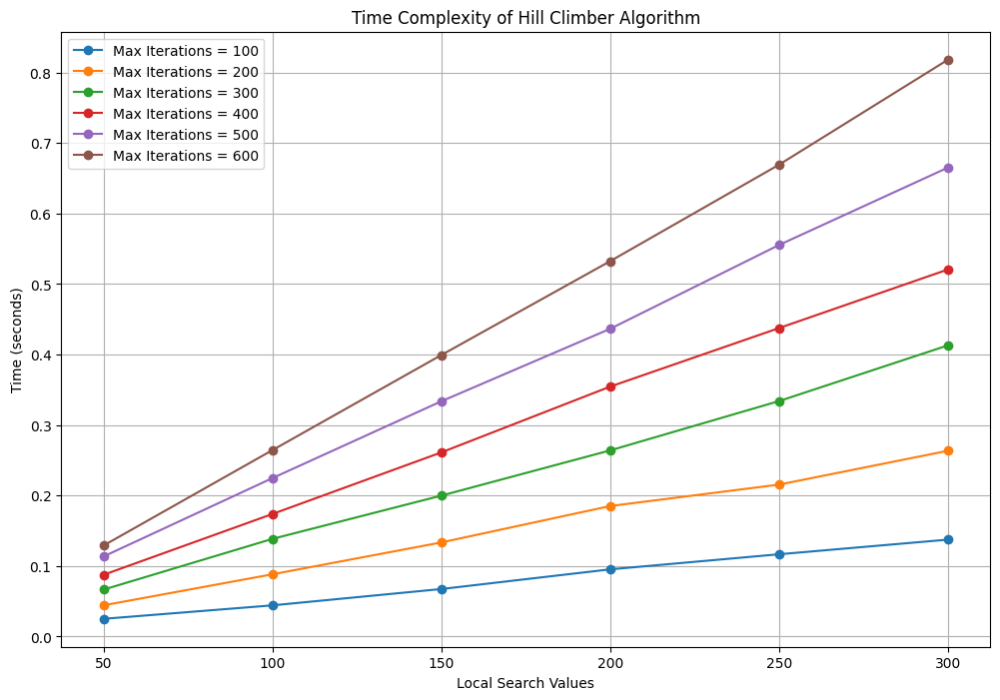
</p>

The running time grows linearly with both the number of iterations and the number of restarts.

## Simulated annealing

Five cooling schedules are compared: linear, logarithmic, exponential, adaptive and a custom one. The comparison looks at exploration vs. exploitation (how often worse solutions are accepted), speed of convergence and the quality of the final solution.

<p align="center">
  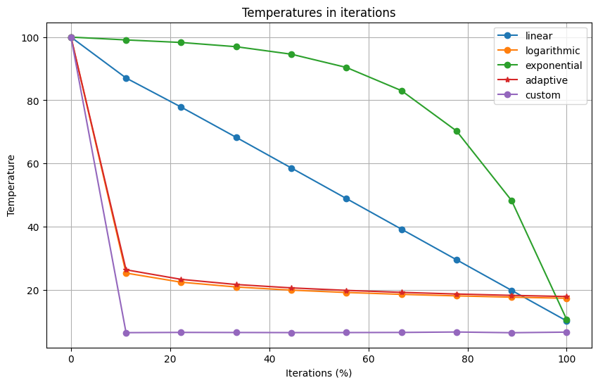
  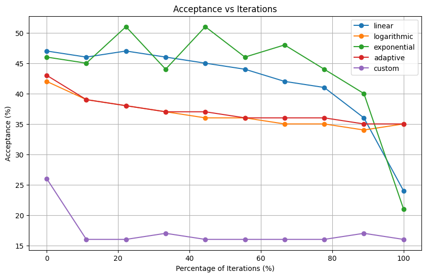
</p>

The exponential schedule cools too quickly at the end and gets stuck in local minima, with an average final fitness of 12.3. The custom schedule gave the best average result (0.44). The logarithmic (0.61) and adaptive (0.62) schedules came next, ahead of linear (0.71).

<p align="center">
  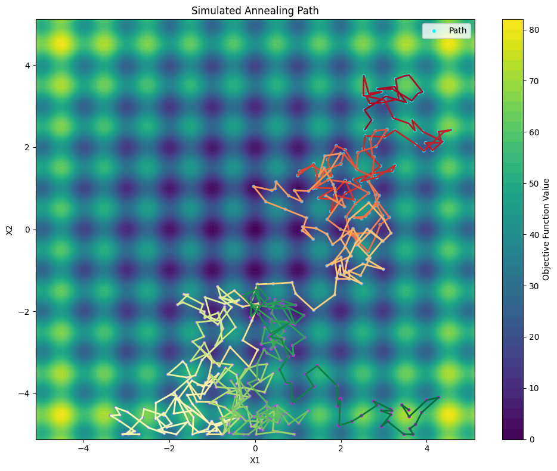
  <br><em>Simulated annealing search path on the Rastrigin function</em>
</p>

## Particle swarm optimization

The swarm is tested on three standard test functions:

<p align="center">
  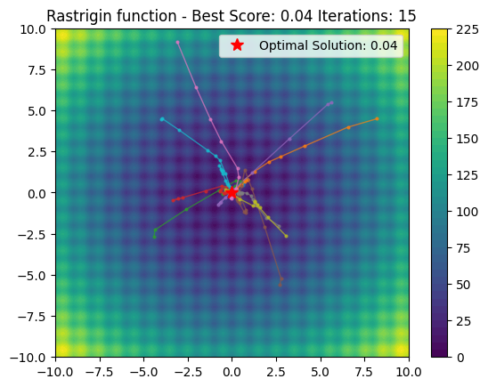
  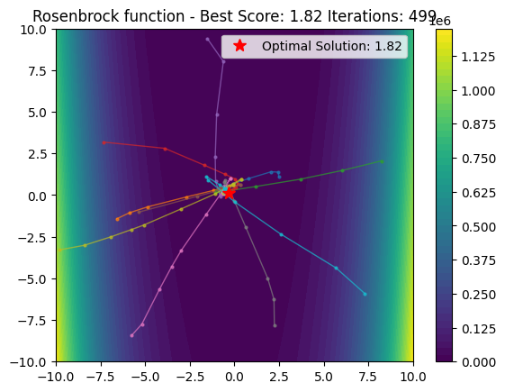
  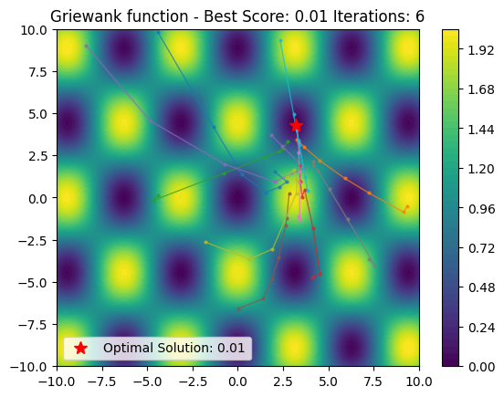
</p>

The sweep over inertia `w`, cognitive `c1` and social `c2` coefficients shows that:

- with `c1 = 0`, the swarm only follows the global best, which makes it behave like a hill climber around one point
- with `c2 = 0`, every particle stays in the local minimum it started in
- with `w = 0`, particles have no momentum

## Ant colony optimization

ACO solves the TSP on instances of 5, 10 and 25 cities. It works best when the parameters are balanced. With `β = 0` the ants ignore distances entirely, and without pheromone evaporation the pheromones pile up and drown out the distance information. A higher `β`, a medium `α` and evaporation of 0.5–0.75 gave the best tours.

## Genetic algorithm

The genetic algorithm implements:

- **selection:** tournament and roulette wheel
- **crossover:** single-point, two-point and uniform
- **mutation:** Gaussian (continuous problems) and bit-flip (binary problems)

The experiments on the knapsack problem show a clear optimal range for the mutation rate. With no mutation, the population loses diversity and stops improving. Too much mutation turns the search into a random walk.

<p align="center">
  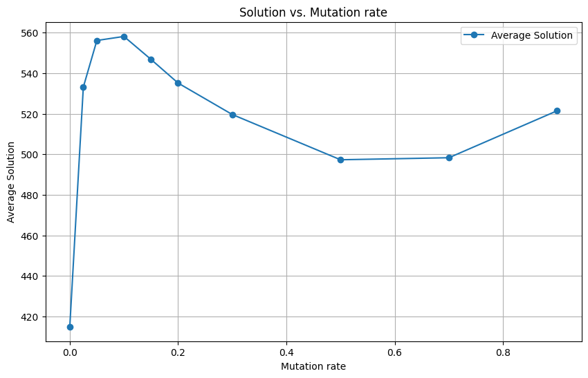
  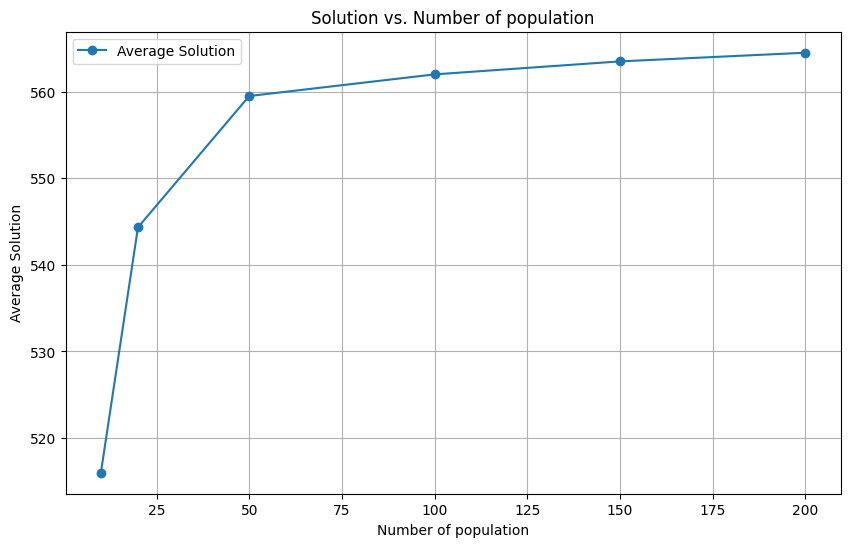
</p>

## Gradient descent

Gradients are estimated numerically with finite differences and compared with the exact derivative for different step sizes `h` and learning rates. On multimodal functions, a small `h` follows the local curvature and gets stuck, while a larger `h` "sees" past local minima. A learning rate that is too high makes the search diverge:

<p align="center">
  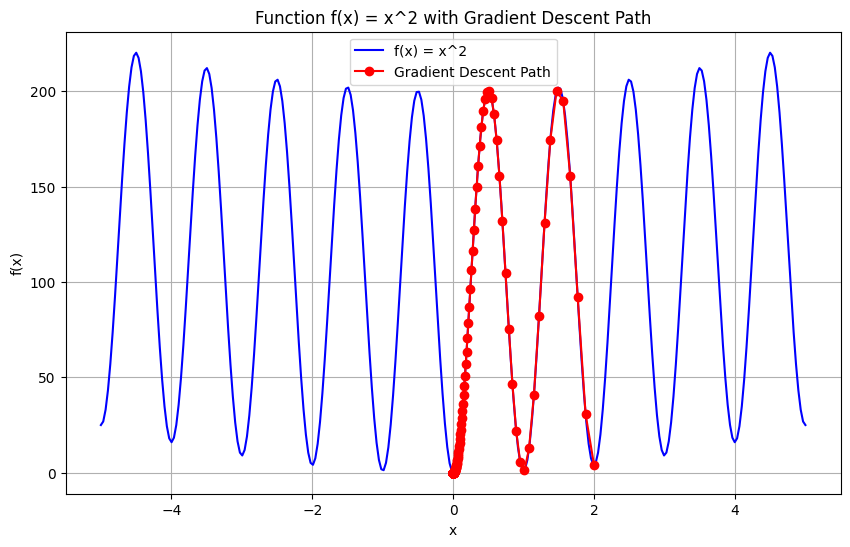
  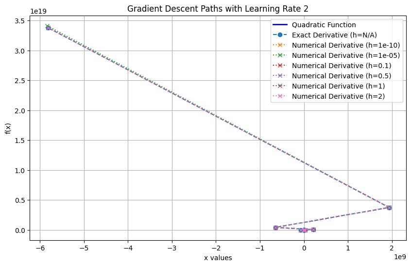
</p>

## Final task, part 1: Vehicle Routing Problem

A fleet of 3 vehicles with different capacities must serve 20 customers from one depot. The constraints are:

- vehicle capacity and customer demand
- time windows and service times, with penalties for late arrival
- a maximum distance and a maximum number of customers per route

Two algorithms solve the problem:

- **Genetic algorithm.** Simulated annealing searches its hyperparameters (mutation rate, elitism count, population size, generations).
- **Ant colony optimization.** Hill climbing searches its hyperparameters (number of ants, iterations, decay, `α`, `β`).

Both searches are then checked with a grid sweep over each parameter.

<p align="center">
  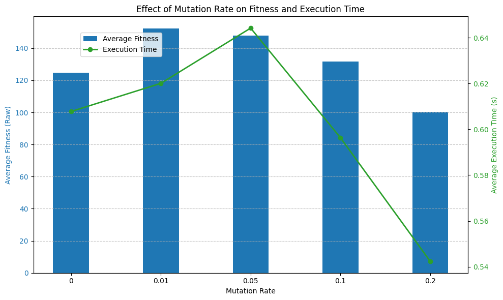
  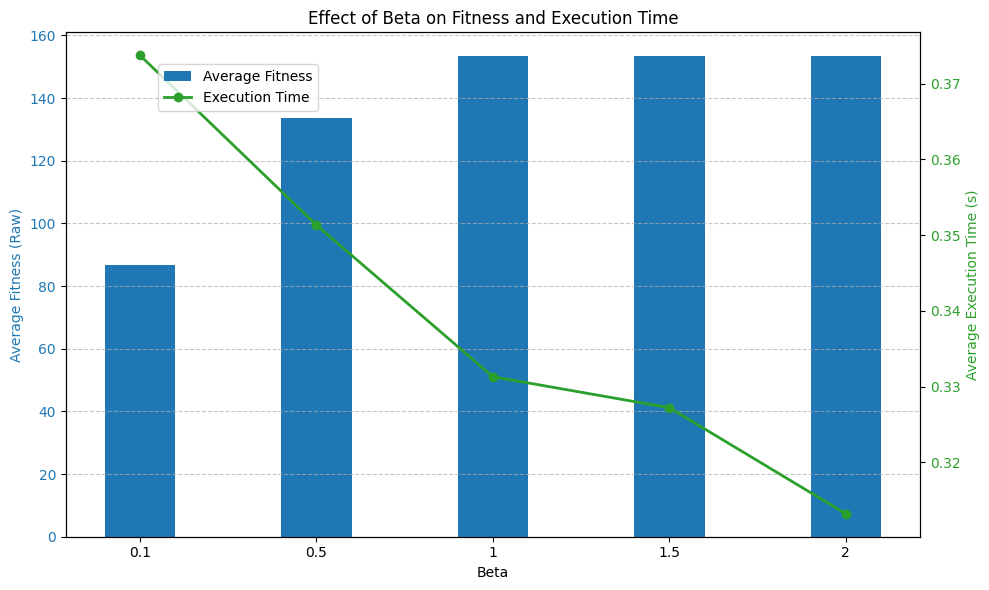
</p>

The grid sweeps agree with the tuned values. Because each vehicle can serve only a few customers, the best mutation rate is very low. A higher elitism count helps the population keep the few valid combinations it finds.

## Final task, part 2: meta-heuristic A*

The algorithms run on generated mazes (recursive backtracking, with optional extra gaps). I designed and compared two A* variants:

- **Meta-heuristic A\*.** Instead of always expanding the best node, it makes a weighted random choice among the `n` best candidates, similar to how ants choose the next city. The weights favour nodes closer to the goal, and the search stops at the first time it reaches the goal.
- **Multi-agent A\*.** Several agents start at waypoints on the diagonal between start and goal. Each one searches for the next waypoint and for the goal, which splits the maze into several smaller ones.

<p align="center">
  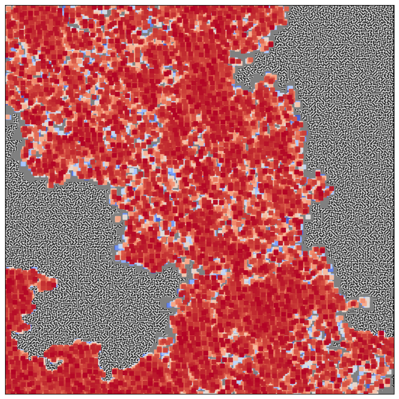
  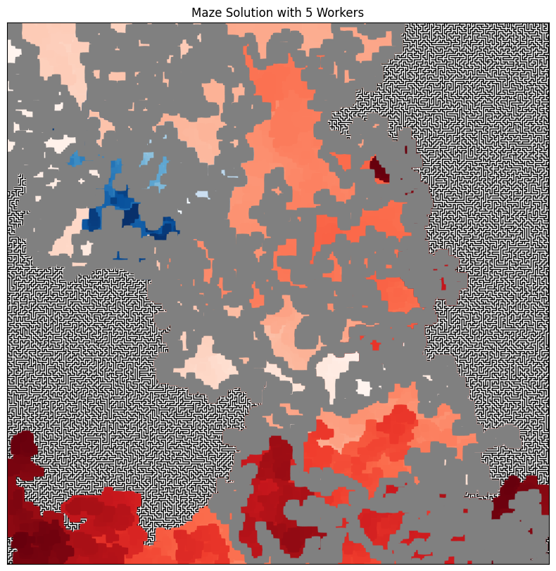
  <br><em>Explored cells: standard A* (left) vs. multi-agent A* with 5 agents (right)</em>
</p>

Compared with standard A*, multi-agent A* in most configurations visits only **4–19% of the cells** and runs in **9–38% of the time**, at the cost of paths 6–24% longer. It works best in mazes with extra gaps, where the agents connect more easily. Meta-heuristic A* visits up to 11% fewer cells. It ended up slower, though, because switching A* to set-based lookups made the standard version much faster.

<p align="center">
  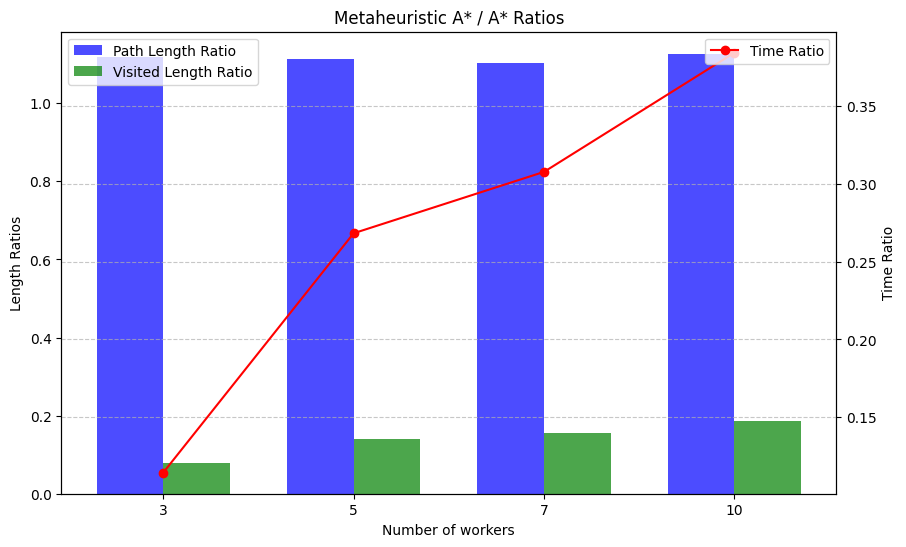
</p>

## Running

```bash
python -m venv .venv
.venv\Scripts\activate          # Windows; use source .venv/bin/activate on Linux/macOS
pip install numpy matplotlib pygad jupyterlab
jupyter lab ProjectGuide.ipynb
```
